# 16-Bit ALU — RTL-to-GDSII ASIC Implementation

A complete **RTL-to-GDSII implementation of a 16-bit Arithmetic Logic Unit (ALU)** using an open-source ASIC flow and the **SkyWater SKY130** process design kit.

The project covers RTL design, self-checking simulation, logic synthesis, floorplanning, placement, clock tree synthesis, routing, signoff checks and final GDSII generation.

---

## 📌 Project Overview

The 16-bit ALU performs 16 operations on two 16-bit operands: arithmetic, Boolean, shift/rotate and compare. The result and four status flags (`zero`, `carry`, `overflow`, `negative`) are captured in an output register, so the design is **synchronous** (clocked, with an active-low asynchronous reset) and goes through a real clock tree synthesis stage.

The RTL was written in **Verilog** and taken through the physical-design flow:

**Verilog → Icarus Verilog / GTKWave → Yosys → OpenLane / OpenROAD → Magic / Netgen / KLayout → GDSII**

---

## 🏗️ Design Flow

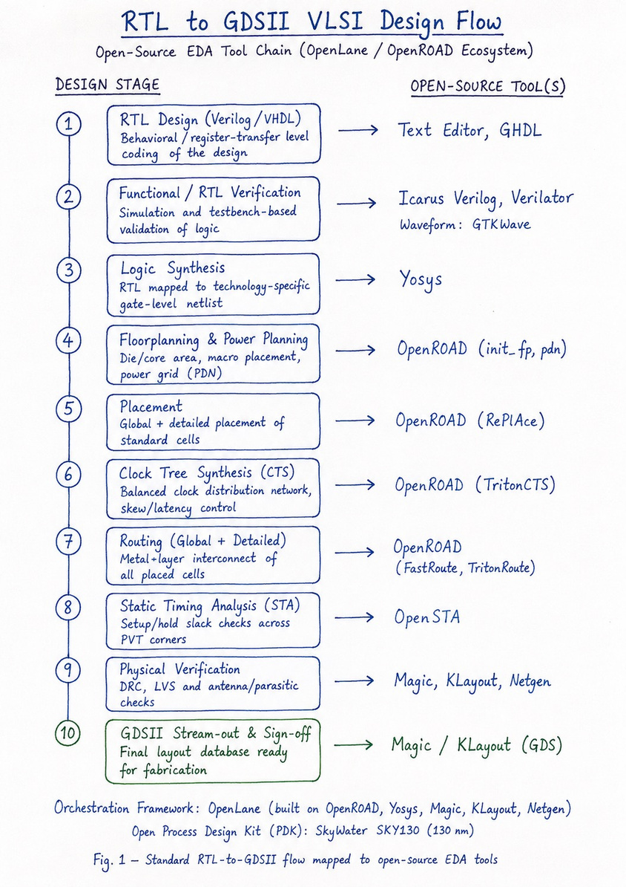

| Stage | Tool |
| ----- | ---- |
| RTL design | Verilog |
| Functional verification | Icarus Verilog, GTKWave |
| Logic synthesis | Yosys |
| Floorplanning, placement, CTS, routing | OpenROAD (via OpenLane) |
| Static timing analysis | OpenSTA |
| DRC | Magic, KLayout |
| LVS | Netgen |
| Layout viewing / GDSII | KLayout |
| PDK / standard cells | SkyWater SKY130A / `sky130_fd_sc_hd` |

---

## 🧩 ALU Architecture

**Top module:** `alu_16bit`

| Port | Direction | Width | Description |
| ---- | --------- | ----- | ----------- |
| `clk` | input | 1 | Clock |
| `rst_n` | input | 1 | Active-low asynchronous reset |
| `a`, `b` | input | 16 | Operands |
| `opcode` | input | 4 | Operation select |
| `result` | output (reg) | 16 | Registered ALU result |
| `zero` | output (reg) | 1 | Result is zero |
| `carry` | output (reg) | 1 | Carry out (ADD) / borrow (SUB) |
| `overflow` | output (reg) | 1 | Signed overflow (ADD, SUB) |
| `negative` | output (reg) | 1 | MSB of result |

The ALU core is a combinational `case` on `opcode`; its outputs are registered on the rising clock edge. Results therefore appear **one clock cycle** after the inputs are applied.

### Opcode Map

| Opcode | Mnemonic | Operation |
| ------ | -------- | --------- |
| `0000` | ADD | `a + b` (sets carry, overflow) |
| `0001` | SUB | `a - b` (sets borrow, overflow) |
| `0010` | INC | `a + 1` |
| `0011` | DEC | `a - 1` |
| `0100` | AND | `a & b` |
| `0101` | OR | `a \| b` |
| `0110` | XOR | `a ^ b` |
| `0111` | NOT | `~a` |
| `1000` | SHL | `a << b[3:0]` |
| `1001` | SHR | `a >> b[3:0]` |
| `1010` | ROL | rotate `a` left by `b[3:0]` |
| `1011` | ROR | rotate `a` right by `b[3:0]` |
| `1100` | EQ | `1` if `a == b`, else `0` |
| `1101` | GT | `1` if `a > b`, else `0` |
| `1110` | LT | `1` if `a < b`, else `0` |
| `1111` | GE | `1` if `a >= b`, else `0` |

> `carry` and `overflow` are only set by ADD and SUB; they are `0` for all other operations. Compare operations return `16'd1` or `16'd0` in `result`. The `default` case returns `0`.

---

## 🧪 Functional Verification

A self-checking testbench (`alu_16bit_tb.v`) compares the DUT against an independent reference model written as a Verilog function. It runs a 100 MHz clock (10 ns period), applies a 2-cycle reset, and runs **19 directed tests** covering all 16 opcodes:

* Arithmetic: ADD, SUB, ADD wraparound (`FFFF + 1`), INC, DEC
* Boolean: AND, OR, XOR, NOT
* Shift/rotate: SHL by 4, SHR by 4, ROL by 1, ROR by 1, SHL by 0
* Compare: EQ (true/false), GT, LT, GE

All tests passed with **0 errors**. Waveforms were inspected in GTKWave.

```bash
iverilog -o alu_tb alu_16bit.v alu_16bit_tb.v
vvp alu_tb
gtkwave alu_16bit_tb.vcd
```

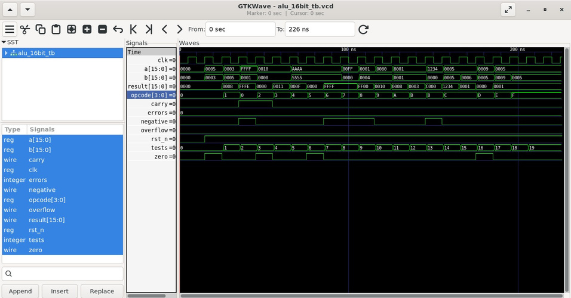

---

## 🏭 Logic Synthesis

The RTL was synthesized with **Yosys** into a gate-level netlist mapped to `sky130_fd_sc_hd`, and the structure was visualized with Yosys' `show` command.

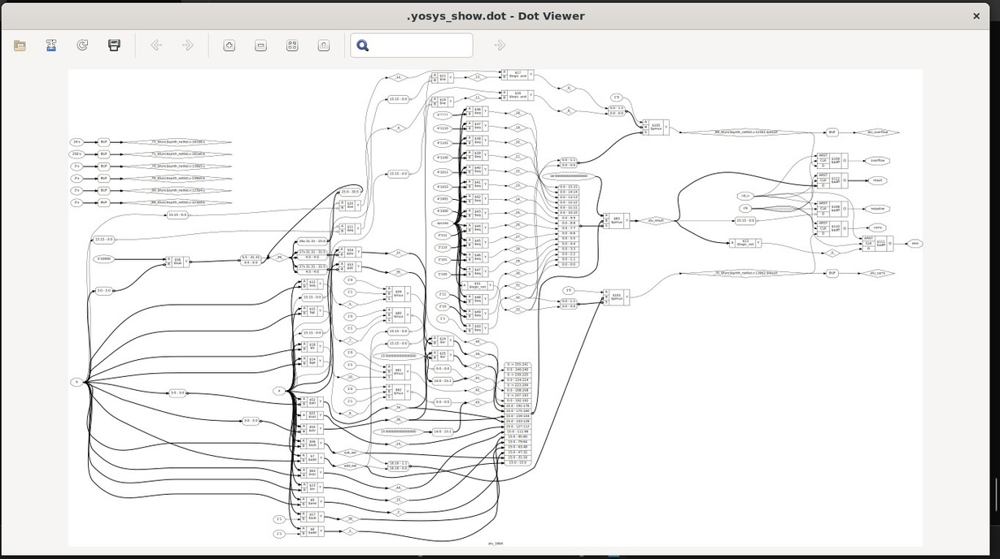

---

## 🏭 ASIC Physical Design

The design was run through OpenLane/OpenROAD (run tag `RUN_2026.08.15_07.01.51`).

### 1. Floorplanning
Die and core regions were defined, rows were generated and the power distribution network was built.

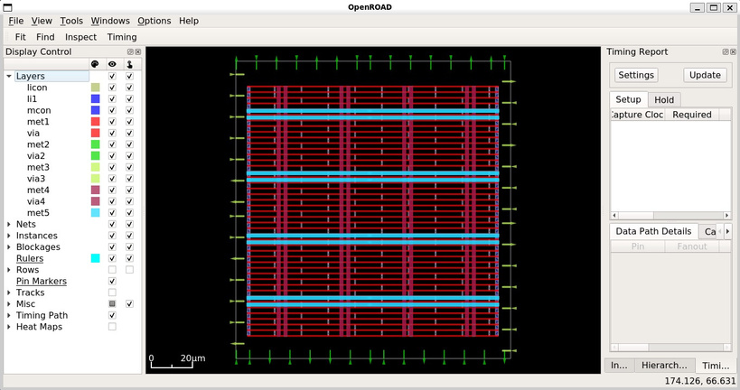

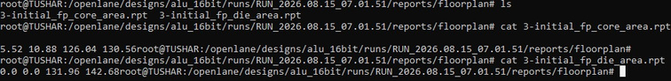

### 2. Placement
Standard cells were placed in the core (global + detailed placement).

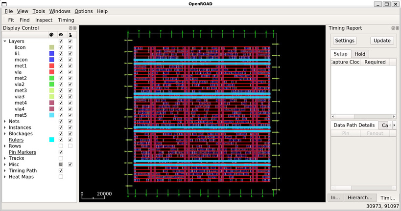

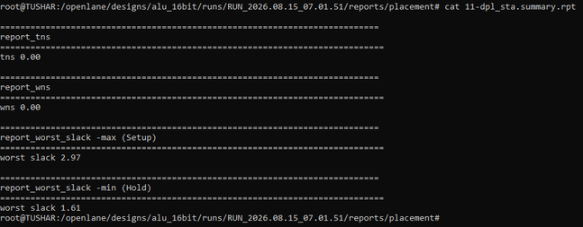

### 3. Clock Tree Synthesis
A clock tree was built with TritonCTS for the registered outputs.

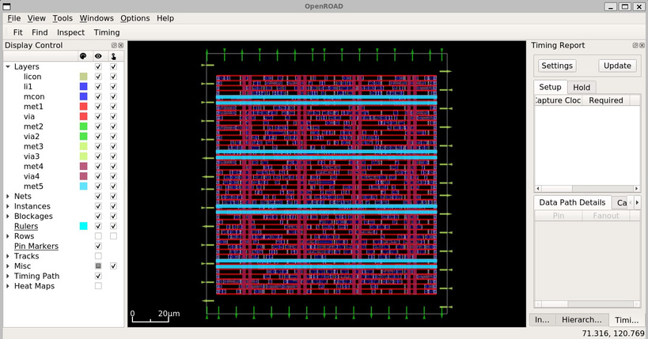

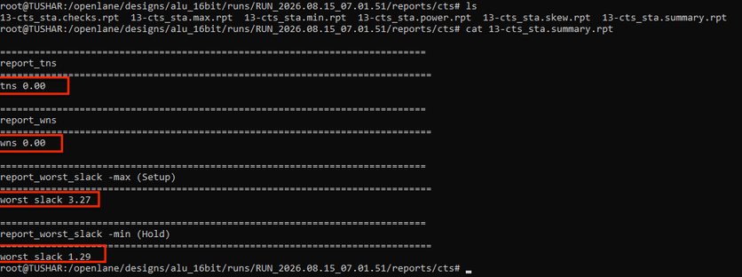

### 4. Routing
Global routing (FastRoute) and detailed routing (TritonRoute) completed with no unrouted nets.

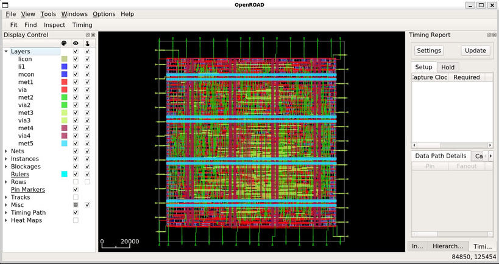

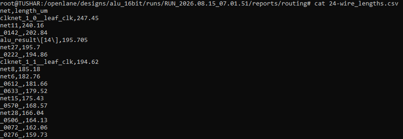

### 5. Signoff and GDSII
Signoff checks were run and the final layout was streamed out as `alu_16bit.gds`.

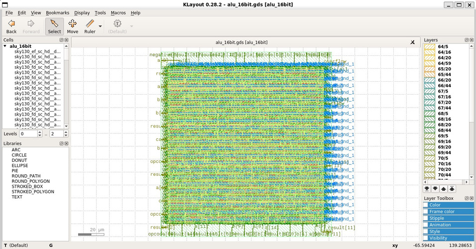

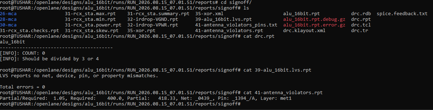

---

## 📊 Results

### Floorplan

| Metric | Value |
| ------ | ----- |
| Die area (coordinates) | 0.0, 0.0 to 131.96, 142.68 µm |
| Core area (coordinates) | 5.52, 10.88 to 126.04, 130.56 µm |

### Timing (OpenSTA, from flow reports)

| Stage | TNS | WNS | Worst setup slack | Worst hold slack |
| ----- | --- | --- | ----------------- | ---------------- |
| Placement | 0.00 ns | 0.00 ns | 2.97 ns | 1.61 ns |
| CTS | 0.00 ns | 0.00 ns | 3.27 ns | 1.29 ns |

Slack is positive for both setup and hold at both stages. Post-route STA reports are also generated in the run's `reports/routing/` directory.

### Routing

* No unrouted nets.
* The longest nets were clock-tree leaf nets: `clknet_1_0__leaf_clk` (247.45 µm) and `clknet_1_1__leaf_clk` (194.62 µm), followed by internal data nets such as `alu_result[14]` (195.7 µm).

### Signoff

| Check | Tool | Result |
| ----- | ---- | ------ |
| DRC | Magic / KLayout | 0 violations |
| LVS | Netgen | Clean: no net, device, pin or property mismatches (total errors: 0) |
| Antenna | OpenROAD antenna check | 1 net flagged: `_0439_`, pin `_1394_/A`, layer `met1` (partial area ratio 418.33 vs. 400.0 required, ratio 1.05) |

> **Note on the antenna result:** the antenna report lists one flagged pin whose partial ratio is slightly above the 400.0 limit. Please review this before describing the layout as fully antenna-clean (see Future Work).

---

## 🔍 Viewing the Layout

```bash
klayout runs/RUN_2026.08.15_07.01.51/results/final/gds/alu_16bit.gds
```

> Adjust the path if your run directory is organized differently.

DRC in Magic (technology `sky130A`) reports `DRC=0`.

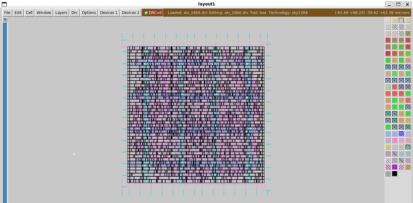

---

## 📁 Project Structure

```text
alu_16bit/
├── src/
│   ├── alu_16bit.v
│   └── alu_16bit_tb.v
├── config.tcl / config.json
├── runs/
│   └── RUN_2026.08.15_07.01.51/
│       ├── reports/
│       └── results/
├── images/
└── README.md
```

> Update this tree to match the actual repository layout.

---

## 🚀 Future Work

* Resolve or waive the flagged antenna violation (`_0439_`, met1) and re-run signoff
* Multi-corner STA across PVT corners
* Power and IR-drop analysis with OpenROAD
* Report cell count, utilization and design area from the final reports
* Scaling to a larger datapath, e.g. a small RISC-V core or pipelined processor
* DFT: scan-chain insertion and ATPG
* QoR benchmarking against a commercial flow on the same RTL

---

## 🎯 Key Takeaway

This project demonstrates a full RTL-to-GDSII flow for a 16-bit ALU using only open-source EDA tools, from Verilog and simulation through synthesis, CTS, routing and DRC/LVS checks on SKY130.

---

## 👨‍💻 Author

**Tushar Kumar**
B.Tech Electronics & Communication Engineering
Ajay Kumar Garg Engineering College, Ghaziabad

---

## ⭐ Project Status

**RTL-to-GDSII flow completed for SKY130A.** DRC and LVS clean; one antenna flag open.
